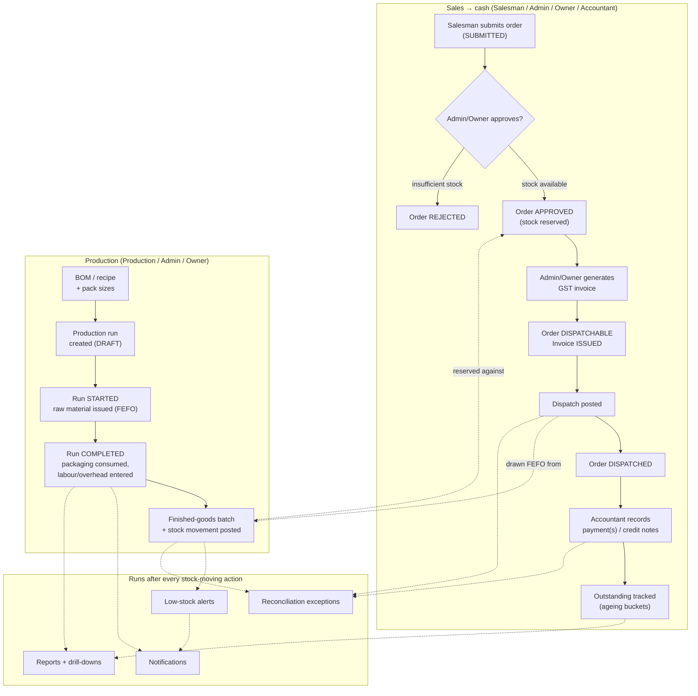

# Porulottam ERP (பொருளோட்டம்)

> Every material. Every process. One connected system.

An Order-to-Audit system for a small South Indian food manufacturer — sales orders, BOM-driven
production, raw material and finished-goods inventory, GST billing, dispatch, payments, costing
and audit reporting, in one role-based application. Built for the NIT Tiruchirappalli internship
shortlisting task.

## Stack

- **Frontend**: React + Vite + TypeScript + Tailwind CSS + React Router + TanStack Query
- **Backend**: Node.js + Express 5 + TypeScript + Prisma 6
- **Database**: PostgreSQL
- **Auth**: JWT (httpOnly cookie) + bcrypt + role-based access control
- **Testing**: Vitest + Supertest (151 tests, run against a real Postgres instance)
- **Invoicing**: PDFKit + Supabase Storage (falls back to local disk) + WhatsApp click-to-chat (`wa.me`)

Five roles: **Salesman**, **Admin**, **Production**, **Accountant**, **Owner** — see
`docs/design-note.md` for what each can do.

## Workflow



The two lanes run independently — a sale doesn't wait for a specific run, it just needs enough
finished-goods stock on hand at approval time, FEFO-drawn from whichever batches exist. Audit,
alerts, notifications and reports never write back into this flow; they only ever read it.

## Local setup

Requires Node.js 20+ and Docker (for local Postgres).

```bash
docker compose up -d
cp .env.example backend/.env   # local Postgres runs on host port 5433

cd backend
npm install
npm run db:migrate
npm run db:seed
npm run dev        # http://localhost:4000

# in a second terminal
cd frontend
npm install
npm run dev         # http://localhost:5173
```

Backend health check: `GET http://localhost:4000/health` → `{"data":{"status":"ok"}}`

Seeded logins (password `password123` for all):

| Role       | Email                        |
|------------|-------------------------------|
| Salesman   | salesman@porulottam.test      |
| Admin      | admin@porulottam.test         |
| Production | production@porulottam.test    |
| Accountant | accountant@porulottam.test    |
| Owner      | owner@porulottam.test         |

## Running the tests

```bash
cd backend
npm test
```

The suite exercises the full order-to-audit flow (orders, approval, invoicing, GST, dispatch,
payments, production variance/costing, reports, audit log) plus every unhappy path (wrong
password, 403s on every role boundary, insufficient-stock approval, duplicate dispatch,
double-complete, concurrent-approval races) — and the features built beyond the mandatory scope:
batch/lot FEFO tracking and expiry, notifications, ledger reconciliation, the production
cost-breakdown drill-down, report drill-downs, and the salesman offline order queue (including its
idempotency-key replay and per-user scoping). `src/benchmark.test.ts` is the single end-to-end
pass that asserts all 11 mandatory benchmark checks below in one run, against the real data the
manual walkthrough produced — not synthetic fixtures.

## The benchmark scenario

The problem statement's own worked example, reproduced exactly against this build:

| # | Check                                       | Value                    |
|---|----------------------------------------------|--------------------------|
| 1 | Flour closing balance                         | 120 kg                    |
| 2 | Oil closing balance                           | 19.5 L                    |
| 3 | Pouches closing balance                       | 306                        |
| 4 | Finished goods, this run's output alone       | 188 packets (238 with opening stock) |
| 5 | Finished goods after Retailer A dispatch      | 88 packets                 |
| 6 | Yield variance                                | −6% (flagged, outside ±3%) |
| 7 | Oil consumption variance                      | +5% (flagged)              |
| 8 | Retailer A invoice                            | ₹7,875                     |
| 9 | Retailer A outstanding                        | ₹3,875                     |
| 10| Distributor B shortage                        | 32 packets                 |
| 11| Cost per packet                               | ₹56.33 — moving weighted-average material cost + ₹500/batch overhead, divided by actual output (see `docs/design-note.md`) |

Self-checks: spice mix closing 3.8 kg, cartons closing 21.

## Beyond the mandatory benchmark

A second round of scope, built on top of the benchmark above once it passed end-to-end (see
`docs/phase-20-additional-improvements-plan.md` for the brief each of these came from):

- **Batch & lot tracking** — FEFO issuing for raw and finished-goods stock, expiry/quarantine
  handling, and forward/backward genealogy (`backend/src/modules/batches`,
  `frontend/src/pages/admin/{Batches,BatchGenealogy}.tsx`).
- **Low-stock alerts** — per-item reorder levels, synced after every stock-moving action
  (`backend/src/modules/alerts`, `frontend/src/pages/admin/LowStockAlerts.tsx`, now also carrying
  the opening-stock form).
- **Notifications** — low-stock, replenishment and production-variance events surfaced through a
  bell in the app shell (`backend/src/modules/notifications`,
  `frontend/src/components/NotificationBell.tsx`).
- **Ledger reconciliation** — read-only cross-checks of the ledger against itself (stock-movement
  completeness, production yield/material variance, packaging, invoice GST totals, dispatch-vs-order
  consistency), tracked and reviewed without ever touching the transactions they were raised against
  (`backend/src/modules/reconciliation`, `frontend/src/pages/admin/Reconciliation.tsx`).
- **Explainable production costing** — a per-run cost breakdown (material/packaging lines, labour,
  overhead, margin against the latest invoice rate) that's a permanent historical snapshot once a
  run completes, with an optional labour/overhead entry at completion time replacing the flat
  ₹500/batch default (`backend/src/modules/production/costing.ts`,
  `frontend/src/pages/production/ProductionRuns.tsx`).
- **Report drill-downs** — every report's aggregate cells (stock on-hand, GST by rate, sales and
  outstanding by customer, production cost) open the real rows behind them in a side drawer, which
  always reconciles exactly with the summary figure it expands (`backend/src/modules/reports`,
  `frontend/src/pages/admin/Reports.tsx`).
- **Offline-safe order entry** — "Recent" customer/product chips, a quantity stepper, a live
  running total, and a post-submit confirmation; a failed submission queues locally and replays
  automatically on reconnect, carrying a per-salesman idempotency key so a replay or an impatient
  retry can never double-post (`frontend/src/lib/api.ts`, `frontend/src/pages/salesman/OrderEntry.tsx`,
  `backend/src/modules/orders/service.ts`).

## Deployment

**Status: configured, not yet deployed to a live URL.** This repo is ready to deploy as-is; the
two steps below need a GitHub remote and Vercel/Render account access that only the project owner
can provide.

### Backend + database — Render

`render.yaml` at the repo root is a Render Blueprint: push this repo to GitHub, then in Render
choose **New → Blueprint** and point it at the repo. It provisions:

- a managed Postgres instance (`porulottam-db`)
- a Node web service (`porulottam-backend`, root directory `backend/`) that on every deploy runs
  `prisma generate` → `prisma migrate deploy` → `tsc` build, then starts with `npm start`

After the first deploy, set these environment variables in the Render dashboard (the blueprint
leaves them blank on purpose — they're either secrets or point at the other service):

- `FRONTEND_ORIGIN` — the deployed Vercel URL, exact, no trailing slash
- `SUPABASE_URL` / `SUPABASE_SERVICE_ROLE_KEY` — optional; omit to use local disk storage for
  invoice PDFs (fine for a demo, but PDFs are lost on every redeploy since Render's local disk
  isn't persistent)
- `MANUFACTURER_GSTIN` — the real manufacturer GSTIN used on every generated invoice

Then seed the fresh database once: `npm run db:seed` via a Render one-off job (or `psql` the
managed Postgres connection string from `backend/prisma/seed.ts` locally).

### Frontend — Vercel

Import the repo into Vercel with **Root Directory** set to `frontend/`. The Vite framework preset
is auto-detected; `frontend/vercel.json` adds the SPA rewrite so client-side routes survive a
page refresh. Set one environment variable:

- `VITE_API_BASE_URL` — the deployed Render backend URL (no trailing slash)

### Re-verifying the benchmark on the deployed environment

Once both are live: sign in as `admin@porulottam.test`, repeat the same walkthrough used to build
the local benchmark (opening stock → BOM → production run → orders → approval → invoice →
dispatch → payment), and confirm the same 11 exact numbers above hold. `docs/demo-video-script.md`
is written to double as this verification script.

## Documentation

- `docs/design-note.md` — 2-page design note: architecture, the data-integrity patterns this
  build relies on, and the decisions the problem statement left open
- `docs/er-diagram.md` — entity-relationship diagram (Mermaid)
- `docs/demo-video-script.md` — the ≤8-minute demo script, scene by scene
- `docs/phase-20-additional-improvements-plan.md` — the brief the "Beyond the mandatory benchmark"
  work above was built from (low-stock alerts, notifications, batch/expiry/FEFO, audit
  reconciliation, explainable costing, evidence-linked reports, salesman UX), with an
  existing-vs-missing feature matrix and a phase-by-phase file-level build spec

## Project structure

```
backend/
  src/modules/<domain>/{router,service,schema}.ts   -- one module per business area
  src/lib/                                          -- AppError, validate, prisma, audit, storage, export
  prisma/schema.prisma                              -- full data model
frontend/
  src/pages/<role-or-area>/                         -- one file per screen
  src/components/{AppShell,ui,NotificationBell}.tsx -- shared layout and design-system primitives
docs/
  design-note.md, er-diagram.md, demo-video-script.md, phase-20-additional-improvements-plan.md
```
