# ER diagram — Porulottam ERP

Generated from `backend/prisma/schema.prisma` by `python docs/gen-er-diagram.py`: every table,
column and foreign key, so re-run it after any schema change instead of editing the block by hand.
GitHub renders Mermaid natively; so does VS Code's Markdown preview with a Mermaid extension.
`PK` primary key, `FK` foreign key, `UK` unique. `||--o{` one-to-many, `||--o|` one-to-one,
`|o--o{` the link is optional.

```mermaid
erDiagram
    BOM_HEADER ||--o{ BOM_LINE : "bomHeader"
    BOM_HEADER ||--o{ PACK_SIZE : "baseBom"
    BOM_HEADER ||--o{ PRODUCTION_RUN : "bomHeader"
    CUSTOMER ||--o{ INVOICE : "customer"
    CUSTOMER ||--o{ SALES_ORDER : "customer"
    DISPATCH ||--o{ DISPATCH_ITEM_BATCH : "dispatch"
    FINISHED_GOODS_BATCH |o--o{ STOCK_MOVEMENT : "finishedGoodsBatch"
    FINISHED_GOODS_BATCH ||--o{ DISPATCH_ITEM_BATCH : "finishedGoodsBatch"
    INVOICE ||--o{ CREDIT_NOTE : "invoice"
    INVOICE ||--o{ INVOICE_ITEM : "invoice"
    INVOICE ||--o{ PAYMENT : "invoice"
    INVOICE ||--o| DISPATCH : "invoice"
    ITEM |o--o{ UNIT_CONVERSION : "item"
    ITEM ||--o{ BOM_HEADER : "finishedItem"
    ITEM ||--o{ BOM_LINE : "rawItem"
    ITEM ||--o{ FINISHED_GOODS_BATCH : "item"
    ITEM ||--o{ INVOICE_ITEM : "item"
    ITEM ||--o{ LOW_STOCK_ALERT : "item"
    ITEM ||--o{ ORDER_ITEM : "item"
    ITEM ||--o{ PACK_SIZE : "finishedItem"
    ITEM ||--o{ PACK_SIZE_LINE : "item"
    ITEM ||--o{ PRODUCTION_RUN_MATERIAL : "item"
    ITEM ||--o{ PURCHASE_ITEM : "item"
    ITEM ||--o{ RAW_MATERIAL_BATCH : "item"
    ITEM ||--o{ STOCK_ADJUSTMENT : "item"
    ITEM ||--o{ STOCK_MOVEMENT : "item"
    PACK_SIZE |o--o{ PRODUCTION_RUN : "packSize"
    PACK_SIZE ||--o{ PACK_SIZE_LINE : "packSize"
    PRODUCTION_RUN ||--o{ PRODUCTION_RUN_MATERIAL : "productionRun"
    PRODUCTION_RUN ||--o| FINISHED_GOODS_BATCH : "productionRun"
    PURCHASE ||--o{ PURCHASE_ITEM : "purchase"
    PURCHASE_ITEM |o--o| RAW_MATERIAL_BATCH : "purchaseItem"
    RAW_MATERIAL_BATCH |o--o{ STOCK_MOVEMENT : "rawMaterialBatch"
    SALES_ORDER ||--o{ INVOICE : "salesOrder"
    SALES_ORDER ||--o{ ORDER_ITEM : "salesOrder"
    SUPPLIER ||--o{ PURCHASE : "supplier"
    SUPPLIER ||--o{ RAW_MATERIAL_BATCH : "supplier"
    USER |o--o{ AUDIT_LOG : "user"
    USER |o--o{ STOCK_ADJUSTMENT : "createdByUser"
    USER |o--o{ STOCK_MOVEMENT : "createdByUser"
    USER ||--o{ SALES_ORDER : "salesmanUser"

    USER {
        string id PK
        string name
        string email UK
        string passwordHash
        Role role
        bool active
        datetime createdAt
    }

    CUSTOMER {
        string id PK
        string name
        string gstin
        string email
        string state
        bool active
        datetime createdAt
    }

    SUPPLIER {
        string id PK
        string name
        string gstin
        string state
        bool active
        datetime createdAt
    }

    ITEM {
        string id PK
        string sku UK
        string name
        ItemType type
        BaseUnit baseUnit
        string hsnCode
        int taxRatePct
        int reorderLevel
        int shelfLifeDays
        int_list expiryWarningDaysJson
        bool active
        datetime createdAt
    }

    LOW_STOCK_ALERT {
        string id PK
        string itemId FK
        int thresholdAtAlert
        int availableQtyAtAlert
        AlertStatus status
        datetime resolvedAt
        datetime createdAt
    }

    UNIT_CONVERSION {
        string id PK
        string itemId FK
        string label
        int factor
    }

    BOM_HEADER {
        string id PK
        string finishedItemId FK
        int expectedYieldQty
        string familyId
        int version
        bool active
        datetime retiredAt
        datetime createdAt
    }

    BOM_LINE {
        string id PK
        string bomHeaderId FK
        string rawItemId FK
        int qtyPerBatch
    }

    PACK_SIZE {
        string id PK
        string finishedItemId FK
        string baseBomId FK
        int multiplier
        string label
        int expectedYieldQty
    }

    PACK_SIZE_LINE {
        string id PK
        string packSizeId FK
        string itemId FK
        int qtyPerBatch
    }

    PURCHASE {
        string id PK
        string supplierId FK
        datetime purchaseDate
        datetime cancelledAt
        datetime createdAt
    }

    PURCHASE_ITEM {
        string id PK
        string purchaseId FK
        string itemId FK
        int qtyBase
        int rateBasePaise
    }

    STOCK_MOVEMENT {
        string id PK
        string itemId FK
        int qtyBase
        int unitCostPaise
        int totalCostPaise
        StockMovementSource source
        string sourceId
        string idempotencyKey UK
        string openingStockItemId UK
        string rawMaterialBatchId FK
        string finishedGoodsBatchId FK
        string createdByUserId FK
        datetime createdAt
    }

    STOCK_ADJUSTMENT {
        string id PK
        string itemId FK
        int qtyBase
        string reason
        string createdByUserId FK
        datetime createdAt
    }

    PRODUCTION_RUN {
        string id PK
        string bomHeaderId FK
        string packSizeId FK
        int batchSize
        ProductionRunStatus status
        int actualOutputQty
        int damagedQty
        int laborCostPaise
        int overheadCostPaise
        datetime startedAt
        datetime completedAt
        datetime cancelledAt
        datetime createdAt
    }

    PRODUCTION_RUN_MATERIAL {
        string id PK
        string productionRunId FK
        string itemId FK
        int plannedQtyBase
        int actualQtyBase
    }

    SALES_ORDER {
        string id PK
        string customerId FK
        string salesmanUserId FK
        SalesOrderStatus status
        string rejectionReason
        datetime createdAt
        string idempotencyKey
    }

    ORDER_ITEM {
        string id PK
        string salesOrderId FK
        string itemId FK
        int qtyBase
        int ratePaise
    }

    INVOICE_SEQUENCE {
        string financialYear PK
        int lastNumber
    }

    INVOICE {
        string id PK
        string salesOrderId FK
        string customerId FK
        string financialYear
        int invoiceNumber
        int taxableValuePaise
        int cgstPaise
        int sgstPaise
        int igstPaise
        int totalPaise
        InvoiceStatus status
        string pdfStoragePath
        datetime createdAt
    }

    INVOICE_ITEM {
        string id PK
        string invoiceId FK
        string itemId FK
        string description
        int qtyBase
        int ratePaise
        int taxableValuePaise
        string hsnCode
        int taxRatePct
    }

    CREDIT_NOTE {
        string id PK
        string invoiceId FK
        string reason
        int amountPaise
        datetime createdAt
    }

    DISPATCH {
        string id PK
        string invoiceId FK,UK
        int qtyBase
        datetime dispatchedAt
    }

    PAYMENT {
        string id PK
        string invoiceId FK
        int amountPaise
        datetime paidAt
    }

    RAW_MATERIAL_BATCH {
        string id PK
        string itemId FK
        string internalBatchNo UK
        string supplierBatchNo
        string supplierId FK
        string purchaseItemId FK,UK
        int receivedQtyBase
        int remainingQtyBase
        datetime receiptDate
        datetime manufactureDate
        datetime expiryDate
        string qualityDocRef
        BatchStatus status
        datetime createdAt
    }

    FINISHED_GOODS_BATCH {
        string id PK
        string itemId FK
        string internalBatchNo UK
        string productionRunId FK,UK
        datetime manufactureDate
        datetime expiryDate
        int producedQtyBase
        int remainingQtyBase
        BatchStatus status
        datetime createdAt
    }

    DISPATCH_ITEM_BATCH {
        string id PK
        string dispatchId FK
        string finishedGoodsBatchId FK
        int qtyBase
    }

    RECONCILIATION_EXCEPTION {
        string id PK
        string checkType
        string sourceType
        string sourceId
        string expectedValue
        string actualValue
        string differenceValue
        AlertSeverity severity
        ExceptionStatus status
        string explanation
        string resolutionNote
        string reviewedByUserId
        datetime reviewedAt
        datetime createdAt
        string dedupeKey UK
    }

    NOTIFICATION {
        string id PK
        string recipientUserId
        Role_list recipientRoles
        NotificationType type
        string title
        string message
        AlertSeverity severity
        string sourceType
        string sourceId
        string dedupeKey UK
        datetime readAt
        datetime createdAt
    }

    AUDIT_LOG {
        string id PK
        string userId FK
        string action
        string entityType
        string entityId
        string beforeJson
        string afterJson
        datetime createdAt
    }
```

## Reading notes

- **`INVOICE_SEQUENCE`** has no foreign keys to anything — it's a single locked counter row per
  financial year (`"2026-27"`), not part of the entity graph; it exists purely so invoice
  numbering is atomic.
- **`STOCK_MOVEMENT`** is the one ledger every physical inventory fact flows through
  (`OPENING_STOCK`, `PURCHASE`, `PRODUCTION_ISSUE`, `PRODUCTION_OUTPUT`, `PRODUCTION_DAMAGE`,
  `PRODUCTION_PACKAGING`, `DISPATCH`, and their reversals) — on-hand and moving-average cost are
  both always computed live from this table, never cached elsewhere.
- **`PRODUCTION_RUN_MATERIAL`** is the only table holding *planned* quantities; actual
  consumption is snapshotted onto the same row once a run starts, so planned-vs-actual variance
  is one join, not a reconciliation across tables.
- **`ITEM`** is a single master for raw materials, packaging and finished goods — the BOM's
  `finishedItemId` and `rawItemId` both point at it, which is why `BOM_LINE`'s raw item and
  `BOM_HEADER`'s finished item are two separate relations to the same table.
- **Recipes are versioned.** Editing a recipe adds a new `BOM_HEADER` row with the same
  `familyId` and the next `version`, and sets `retiredAt` on the old one. A `PRODUCTION_RUN` keeps
  pointing at the version it was planned with, so a recipe change never alters a planned or
  finished run.
- **`PACK_SIZE` / `PACK_SIZE_LINE`** let one recipe make more than one pack (e.g. 200 g and
  500 g): each pack has its own finished item, expected packets per batch and packaging lines.
  A run's `packSizeId` is fixed when it is planned.
- **Batches.** `RAW_MATERIAL_BATCH` (from purchases) and `FINISHED_GOODS_BATCH` (one per finished
  run) carry lot numbers, expiry and remaining quantity; issues pick the oldest batch that hasn't
  expired first. `DISPATCH_ITEM_BATCH` records which finished batch each dispatch took from, so a
  lot can be traced from supplier to customer.
- **`SALES_ORDER.status`** runs SUBMITTED → APPROVED → DISPATCHABLE (invoiced) → DISPATCHED, or
  ends REJECTED, or CANCELLED when its invoice is credit-noted before dispatch. APPROVED and
  DISPATCHABLE orders hold their packets aside from what is available.
- **`LOW_STOCK_ALERT`**, **`NOTIFICATION`** and **`RECONCILIATION_EXCEPTION`** are derived: each
  is created from the ledger and orders (a reorder level crossed, an order moving on, a check
  that doesn't add up) and never feeds back into stock or money.
- **`STOCK_MOVEMENT` and `AUDIT_LOG` are append-only**: a database trigger refuses any update or
  delete, so corrections are always new rows.
