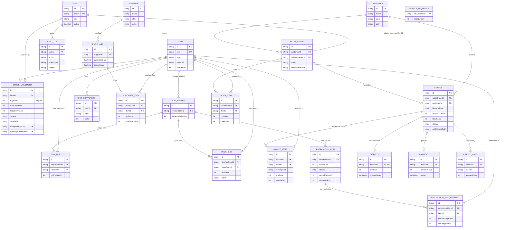

# ER diagram — Porulottam ERP

Generated from `backend/prisma/schema.prisma`. Render with any Mermaid-compatible viewer (GitHub
renders this natively; VS Code's Markdown preview with a Mermaid extension works too).

## Reading notes

- **`INVOICE_SEQUENCE`** has no foreign keys to anything — it's a single locked counter row per
  financial year (`"2026-27"`), not part of the entity graph; it exists purely so invoice
  numbering is atomic.
- **`STOCK_MOVEMENT`** is the one ledger every physical inventory fact flows through
  (`OPENING_STOCK`, `PURCHASE`, `PRODUCTION_ISSUE`, `PRODUCTION_OUTPUT`, `PRODUCTION_DAMAGE`,
  `PRODUCTION_PACKAGING`, `DISPATCH`, and their reversals) — on-hand and moving-average cost are
  both always computed live from this table, never cached elsewhere.
- **`PRODUCTION_RUN_MATERIAL`** is the only table holding *planned* quantities; actual
  consumption is snapshotted onto the same row once a run starts, so planned-vs-actual variance
  is one join, not a reconciliation across tables.
- **`ITEM`** is a single master for raw materials, packaging and finished goods — the BOM's
  `finishedItemId` and `rawItemId` both point at it, which is why `BOM_LINE`'s raw item and
  `BOM_HEADER`'s finished item are two separate relations to the same table.
